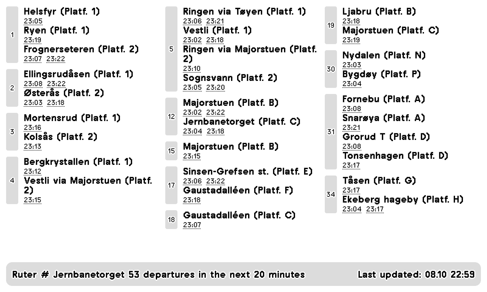

# TRMNL Norway Departures

Shows real-time public transport departures for any stop in Norway on a [TRMNL](https://usetrmnl.com/) e-ink display.



*Rendered with TRMNL's own stylesheet from live data for Jernbanetorget, Oslo.*

## Install

The plugin is published as a TRMNL recipe called **Ruter / Entur Norway**:

1. Open the [recipe page](https://trmnl.com/recipes/20164), or search for "Ruter" in the TRMNL recipes.
2. Install it on your device.
3. Fill in the settings below.

## Settings

| Setting | Default | Description |
|---|---|---|
| **Station** | `NSR:StopPlace:58366` (Jernbanetorget) | The stop to show. Go to [entur.no/kart](https://entur.no/kart), search for your stop and copy the code from the URL. |
| **Excluded platforms** | (none) | Some stops have several platforms under the same name. List the ones you are not interested in, for example `A,B`. |
| **Excluded lines** | (none) | Lines you are not interested in, for example `5,FB1A`. |
| **Minutes to fetch** | `30` | How many minutes into the future departures are fetched. |

Departures in the next 3 minutes are left out.

## How it works

TRMNL can only poll a URL and render what comes back, so the plugin has two parts:

1. **A cloud function** (`src/cloud-function/trmnl.py`) asks the [Entur](https://developer.entur.org/) journey planner API for the next departures at a stop, groups them by line, destination and platform, and returns compact JSON.
2. **Liquid templates** (`plugin/src/`, one per layout) turn that JSON into the three-column departure board above. TRMNL commits every save there, and changes pushed to GitHub reach TRMNL once they are imported.

Entur is the national travel data hub, so this works for metro, tram, bus, rail, coach and boat stops anywhere in Norway, not only in Oslo.

The function returns JSON like this:

```json
{
  "departures": {
    "1": {
      "Helsfyr - 1": [
        { "schedule": "23:04.00", "expected": "23:05.06", "type": "metro" }
      ],
      "Ryen - 1": [
        { "schedule": "23:19.00", "expected": "23:19.00", "type": "metro" }
      ]
    }
  },
  "last_updated": "20:59",
  "minutes_to_fetch": 20,
  "num_departures": 53,
  "num_departures-excludes": 53,
  "name": "Jernbanetorget",
  "exclude_platforms": "",
  "exclude_lines": "",
  "fetch_limit": 200
}
```

`departures` is keyed by line, then by `destination - platform`. `schedule` is the timetable time and `expected` the real-time estimate. `last_updated` is in UTC.

## Development

```sh
pip install -r src/cloud-function/requirements.txt -r requirements-dev.txt

# Run the tests
PYTHONPATH=src/cloud-function pytest tests/

# Print the departures for a stop in the terminal
python src/cloud-function/trmnl.py
```

CI runs the tests on every push and pull request. A scheduled health check calls the deployed function every two hours and can notify through Pushover or Telegram when it stops returning departures.

## License

MIT, see [LICENSE](LICENSE).
